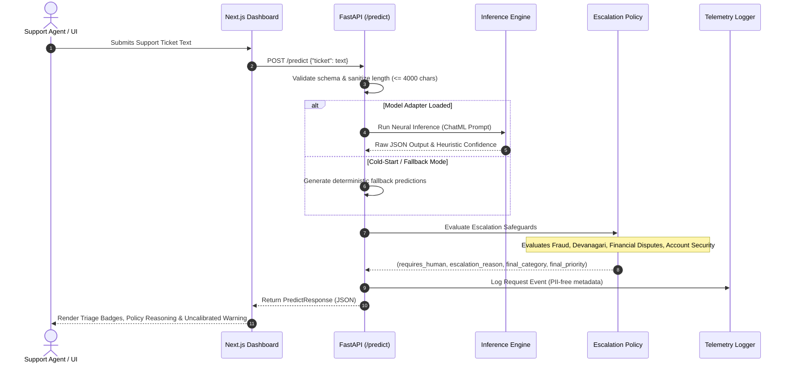

# NEXUS-SLM — Project Architecture & System Topology

## 1. Executive Architecture Summary

NEXUS-SLM (*Neural EXecution for Unified Support Intelligence*) is an edge-specialized Small Language Model system designed for low-latency, privacy-preserving, multilingual customer support ticket triage.

The system combines a 135M parameter SLM specialized via QLoRA with a deterministic rule-based safety policy engine, providing guaranteed escalation behaviors that cannot be overridden by model hallucination or uncalibrated confidence scores.

```
+-----------------------------------------------------------------------------------+
|                              PRESENTATION LAYER                                   |
|   Next.js 14 Dashboard (Port 3000)                                                |
|   - Interactive Triage & 30 Multi-Lingual Presets                                 |
|   - Zero-Downtime Rollback Controls                                               |
|   - Telemetry, Hardware & Drift Observability                                     |
+------------------------------------------+----------------------------------------+
                                           | HTTP Reverse Proxy (/api/backend/*)
+------------------------------------------v----------------------------------------+
|                               SERVICE LAYER                                       |
|   FastAPI REST Service (Port 8000)                                                |
|   - Strict Pydantic Contract Validation (PredictRequest / PredictResponse)        |
|   - Request Tracing (UUID request_id)                                             |
|   - Model Registry Management (/model, /model/rollback, /registry)                |
|   - Privacy-Safe Telemetry Logger (monitoring/telemetry.py)                       |
+------------------------------------------+----------------------------------------+
                                           |
+------------------------------------------v----------------------------------------+
|                           INFERENCE & SAFETY PIPELINE                             |
|                                                                                   |
|  +------------------------------+       +--------------------------------------+  |
|  |   Neural Inference Engine    |       |    Deterministic Safeguard Policy    |  |
|  |  (src/inference/engine.py)   |       |      (src/inference/policy.py)       |  |
|  | - SmolLM-135M-Instruct       |       | - Fraud / Security (Critical)        |  |
|  | - LoRA Adapter (r=16, a=32)  | ----> | - Native Devanagari Hindi Fallback   |  |
|  | - Deterministic Greedy (T=0) |       | - Financial Dispute Protection       |  |
|  | - Strict JSON Parser         |       | - Low-Confidence (<0.85) Intercept   |  |
|  +------------------------------+       +--------------------------------------+  |
+-----------------------------------------------------------------------------------+
```

---

## 2. End-to-End Request Lifecycle



---

## 3. Core Subsystems

### 3.1 Inference Engine & Model Loader
- **Base Architecture:** `HuggingFaceTB/SmolLM-135M-Instruct` (135,436,608 total parameters).
- **Specialization Technique:** QLoRA with rank $r=16$, $\alpha=32$, targeting projection matrices `[q_proj, k_proj, v_proj, o_proj]` (921,600 trainable parameters, 0.68% parameter overhead).
- **Adapter Storage:** `models/nexus_qlora_v1/` (`adapter_model.safetensors`, 3.7 MB).
- **Decoding Strategy:** Deterministic greedy decoding ($T=0.0$, `do_sample=False`, `max_new_tokens=45`) ensuring 100% reproducible classifications without sampling variance.
- **Output Validation:** `OutputParser` enforces strict JSON schema adherence with regex fallback extraction.

### 3.2 Deterministic Safety Policy Engine
To protect against small language model hallucinations and overconfidence, `HumanEscalationPolicy` enforces immutable safety invariants:

1. **Adversarial / Injection Defense:** Keywords attempting system prompt overrides trigger immediate escalation (`adversarial_prompt_injection_detected`).
2. **Fraud & Financial Dispute Zero-Tolerance:** Keywords matching unauthorized charges, card theft, double deductions, or hacking force `requires_human=True` and promote priority to `critical`.
3. **Native Devanagari Hindi Protection:** Byte-Pair Encoding (BPE) subword fragmentation on Devanagari Unicode (`[\u0900-\u097F]`) fragments Hindi text into 3–5 byte tokens per character, causing representational degradation. The policy deterministically routes **100% of Devanagari Hindi tickets** to human review (`native_hindi_devanagari_unreliable_tokenization`).
4. **Account Closure & GDPR:** Deletion and legal requests are escalated (`legal_or_account_closure_action`).
5. **Low Confidence Floor:** Tickets with uncalibrated heuristic confidence below $0.85$ are flagged for human verification.

### 3.3 Zero-Downtime Rollback & Model Registry
- Models are cataloged in [`models/registry.json`](file:///c:/Users/avira/OneDrive/Desktop/NEXUS-SLM/models/registry.json).
- The `POST /model/rollback?target_version=...` endpoint switches the active model pointer and loads candidate weights in memory without container restarts.
- If a target model lacks specialized weights (e.g. `baseline-smollm-135m`), the system transitions to deterministic fallback mode without dropping requests.

### 3.4 Telemetry & Observability
- `TelemetryLogger` tracks request counts, latency percentiles (P50, P95, P99), human escalation ratios, and data drift (Population Stability Index - PSI).
- **Privacy Control:** Customer ticket text is never written to disk or logs; only character length and classification tags are recorded.

---

## 4. Operational Boundaries & Blocker Status

The application is structured to run locally in demonstration mode while preserving absolute boundaries against premature production activation:

| Boundary | Enforcement Mechanism | Current Operational State |
| :--- | :--- | :--- |
| **CRM Connection** | Mock / disabled in configuration | **DISABLED** (No CRM credentials exist) |
| **Autonomous Action** | Zero ticketing mutation APIs | **PROHIBITED** (Read-only triage output only) |
| **Real Customer Data** | Synthetic fixtures exclusively | **ENFORCED** (No live ingestion) |
| **Activation Status** | Governed by blocker packages | `BLOCKED — ACTIVATION REQUIREMENTS UNMET` |
