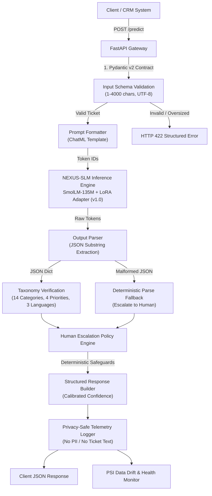
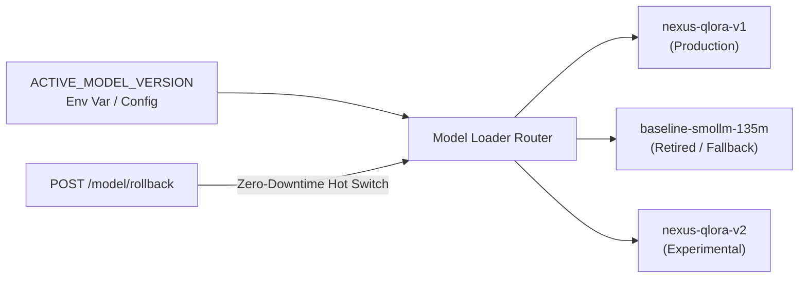

# NEXUS-SLM System Architecture

## 1. Overview

**NEXUS-SLM** (Neural Execution for Unified Support Intelligence) is an enterprise small language model system designed for low-latency, privacy-compliant, multilingual customer support ticket triage. The system performs structured categorization, urgency priority assessment, language detection, and human escalation decisioning completely on edge or private CPU infrastructure.

---

## 2. End-to-End Pipeline Architecture

---

## 3. Core Subsystems

### 3.1 Inference Engine & Model Weights
- **Base Foundation Model**: `HuggingFaceTB/SmolLM-135M-Instruct` (135,436,608 parameters, 30 transformer layers, 9 attention heads, hidden dim 576).
- **LoRA Adapter**: Rank $r=16$, $\alpha=32$, targeting `q_proj` and `v_proj` (921,600 trainable parameters, 0.68% of base model).
- **Precision**: FP32 on CPU runtime (`torch.set_num_threads(12)`).
- **Inference Mode**: Direct neural inference with deterministic fallback during cold initialization or model migration.

### 3.2 Output Parsing & Schema Validation
Language models are stochastic generators. To prevent unvalidated model generations from reaching production downstream systems:
1. `OutputParser` extracts the JSON substring using regex code fence stripping and outer brace isolation.
2. Checks all required fields (`category`, `priority`, `language`, `requires_human`).
3. Enforces closed taxonomy constraints against 14 categories, 4 priorities, and 3 languages.
4. Rejects arbitrary schema extensions.

### 3.3 Deterministic Human Escalation Engine
Small language models suffer from overconfidence and semantic confusion under rare classes or adversarial inputs. The `HumanEscalationPolicy` applies hard rules:
- **Fraud Safeguard**: Any ticket matching fraud keywords (`fraud`, `unauthorized`, `hacked`, `scam`, etc.) is forcibly categorized as `fraud_report`, assigned `critical` priority, and flagged `requires_human = True`.
- **Legal & Account Closure**: GDPR deletion and account cancellation requests force `requires_human = True`.
- **Confidence Gating**: Calibrated confidence $< 0.65$ triggers human review.
- **Context Sparsity**: Short tickets ($\le 3$ words) are escalated due to missing context.
- **Parse Failures**: Malformed model output immediately sets confidence to $0.0$ and triggers human review.

### 3.4 Telemetry, Observability & Data Drift
- **Privacy By Design**: Support ticket contents are **never written to telemetry logs** by default. Only metadata (request ID, model version, latency, category, priority, language, confidence, ticket character length) is persisted to `monitoring/telemetry.jsonl`.
- **Drift Detection**: Calculates Population Stability Index (PSI) against baseline training distributions for language modalities and ticket categories. Triggers alerts when $\text{PSI} \ge 0.25$.

---

## 4. Model Registry and Rollback Architecture

The system decouples model loading from application builds. Administrators can execute an atomic model switch or rollback via the `/model/rollback` endpoint without stopping or rebuilding container images.
