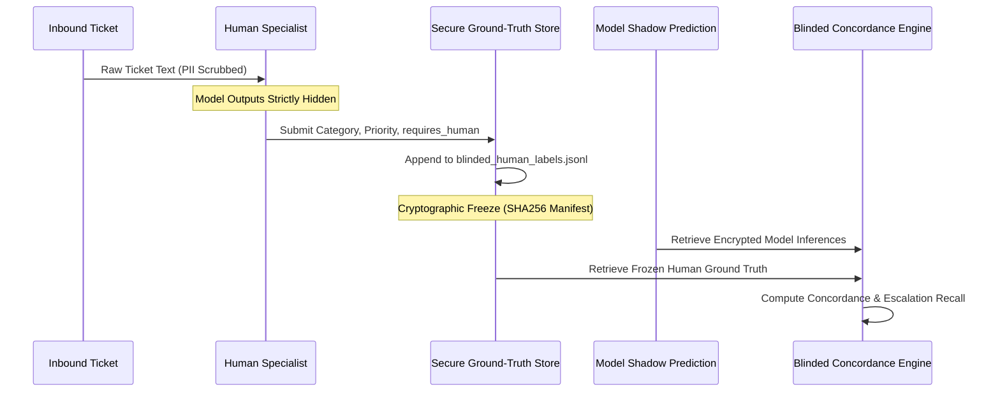

# NEXUS-SLM — Reviewer Onboarding & Double-Blind Labeling Package

**Document ID**: `REVIEW-ONBOARD-2026-V1`  
**Governing Blocker**: `BLK-03 — Human-review panel`  
**Target Candidate**: `nexus-qlora-v1` (Git Commit: `2696df8be85e75b69f8a04345265c7f29d931e02`)  
**Designated Owner**: Support Operations Lead & Quality Assurance Manager  
**Current Operational Status**: `BLOCKED — PENDING WORKFORCE ROSTERING & SHIFT CONFIRMATION`  

---

## 1. Executive Context & Purpose

This package establishes the qualifications, rostering procedures, blinding mechanics, consensus protocols, and cryptographic evidence preservation required to resolve **BLK-03**.

> [!IMPORTANT]
> **Anti-Bias & Blinding Invariant**:  
> To guarantee scientific and operational validity during the prospective shadow pilot, **human reviewers must evaluate tickets completely blind to model outputs**. Model predictions, confidence scores, and automated escalation flags must NEVER be displayed to human reviewers prior to the cryptographic sealing of human ground-truth labels.
> 
> *Note: This document provides the operational framework and blank rostering templates. No named individuals or confirmed schedules have been fabricated.*

---

## 2. Reviewer Qualifications & Eligibility Criteria

To be eligible for the prospective evaluation panel, reviewers must satisfy the following four qualification standards:

1. **Domain Experience**: Minimum 12 months in Tier-2/Tier-3 customer support, billing operations, or trust & safety triage.
2. **Taxonomy Mastery**: Demonstrated 100% calibration on the closed 14-class NEXUS taxonomy definitions:
   - `payment_failure`, `refund_request`, `account_access`, `password_reset`, `order_cancel`, `order_tracking`, `subscription`, `billing`, `technical_issue`, `fraud_report`, `delivery_issue`, `account_closure`, `product_complaint`, `general_query`.
3. **Multilingual Competency**: Working fluency in English, conversational Hinglish (code-switched Roman Hindi), and script comprehension of native Devanagari Hindi.
4. **Safety Escalation Acumen**: Familiarity with statutory compliance requirements (GDPR Article 17 deletion, PCI-DSS fraud disputes, account lockout protocols).

---

## 3. Reviewer Roster & Availability Verification

To satisfy BLK-03, a minimum of **five qualified support specialists** must be formally rostered with verified shift availability across the 14-day shadow pilot window.

### 3.1 Panel Rostering Form (To be completed by Support Ops Lead)

```
========================================================================================
                      NEXUS-SLM SHADOW PILOT REVIEWER ROSTER
========================================================================================
 Reviewer ID   Specialist Name   Support Tier   Weekly Capacity   Confirmed Shift Hours
----------------------------------------------------------------------------------------
 REV-01        [PENDING]         [Tier 2/3]     [50-100 tickets]  [e.g., 09:00-17:00 UTC]
 REV-02        [PENDING]         [Tier 2/3]     [50-100 tickets]  [e.g., 09:00-17:00 UTC]
 REV-03        [PENDING]         [Tier 2/3]     [50-100 tickets]  [e.g., 13:00-21:00 UTC]
 REV-04        [PENDING]         [Tier 2/3]     [50-100 tickets]  [e.g., 17:00-01:00 UTC]
 REV-05        [PENDING]         [Tier 2/3]     [50-100 tickets]  [e.g., 21:00-05:00 UTC]
 Lead Reviewer [PENDING]         [Lead / QA]    [Adjudication]    [On-call Escalations]
========================================================================================
```

### 3.2 Availability & Commitment SLA
- Each rostered specialist must commit to evaluating a minimum of **50–100 prospective tickets per week**.
- The combined panel must maintain capacity to evaluate the prospective target cohort of $\ge 500$ double-blind tickets across the 14-day pilot.

---

## 4. Double-Blind Labeling Procedure

The double-blind ground-truth workflow is implemented in [src/pilot/evaluation_protocol.py](file:///c:/Users/avira/OneDrive/Desktop/NEXUS-SLM/src/pilot/evaluation_protocol.py):



### 4.1 Blinding Rules
1. **Zero Model Visibility**: Reviewers see ONLY the sanitized customer ticket body and ticket ID.
2. **No Real-Time Feedback**: Reviewers receive no hints, probabilities, or automated suggestions.
3. **Independent Recording**: Reviewer judgments are appended directly to `data/pilot/blinded_human_labels.jsonl` using the command interface:
   ```bash
   .venv\Scripts\python.exe -c "
   from src.pilot.evaluation_protocol import PilotEvaluationProtocol
   proto = PilotEvaluationProtocol()
   proto.record_blinded_human_label(
       ticket_id='TICK-1001',
       sanitized_text='My credit card was charged twice for order 5521.',
       human_category='payment_failure',
       human_priority='high',
       human_requires_human=True,
       reviewer_id='REV-01',
       risk_type='financial_dispute',
       notes='Double charge dispute'
   )
   "
   ```

---

## 5. Disagreement Resolution & Adjudication Protocol

When independent reviewers evaluate the same ticket and submit conflicting labels:

1. **Category Disagreements (Routine Classes)**:
   - E.g., `order_tracking` vs `delivery_issue`.
   - The ticket is assigned to a third independent reviewer.
   - If consensus (2/3) is achieved, the majority label is adopted.
   - If split (3 distinct labels), the Lead QA Adjudicator assigns the authoritative taxonomy class.
2. **Escalation Safety Disagreements (`requires_human`)**:
   - If ANY reviewer flags `requires_human=true` due to suspected fraud, legal, security, or harassment risk, the ticket is **conservatively treated as `requires_human=true`** for safety recall scoring.
   - Over-escalation is analyzed separately under false-positive governance.

---

## 6. High-Risk Incident Escalation Protocol

If an evaluated ticket involves an active safety incident (e.g. ongoing credential theft, ransomware, legal subpoena, physical threat):
1. **Immediate Operational Escalation**: The reviewer must immediately escalate the ticket ID to the human incident queue (`tier3-security-triage`) independently of the evaluation study.
2. **Evaluation Tagging**: The record is tagged with `risk_type = "high_risk_incident"` and audited against the model's prediction.
3. **Sev-1 Investigation**: If the model output for this ticket returned `requires_human=false`, an automated **Sev-1 Safety Escape** investigation is triggered under the 5-minute incident SLA.

---

## 7. Cryptographic Evidence Preservation

Human ground truth must be cryptographically sealed before model predictions are compared:

### 7.1 Ground-Truth Freezing Command
```bash
# Executed by Support Ops Lead upon accumulating evaluation cohort
.venv\Scripts\python.exe -c "
from src.pilot.evaluation_protocol import PilotEvaluationProtocol
proto = PilotEvaluationProtocol()
manifest = proto.freeze_pilot_ground_truth()
print(f'Ground truth frozen: {manifest}')
"
```

### 7.2 Storage Guarantees
- **Immutable JSONL**: `data/pilot/frozen_pilot_ground_truth.jsonl` is written with read-only filesystem attributes.
- **SHA256 Manifest**: A cryptographic checksum is saved to `data/pilot/ground_truth_freeze_manifest.json`. Any subsequent alteration invalidates the manifest hash.
- **Data Quarantine**: Evaluation records are quarantined from development directories (`data/train/`, `data/validation/`) to prevent training data leakage.

---

## 8. Formal Reviewer Panel Sign-Off

*To be executed by the Support Operations Lead upon confirming reviewer assignments and schedule availability.*

```
========================================================================================
                     NEXUS-SLM REVIEWER PANEL OPERATIONAL SIGN-OFF
========================================================================================

Support Operations Lead Approval:
Name:      __________________________________________________
Title:     Support Operations Lead / Director of Customer Support
Signature: __________________________________________________  Date: _______________

Confirmation Checklist:
[ ] 5+ qualified support specialists rostered and trained on the 14-class taxonomy.
[ ] Multilingual competency verified across English, Hinglish, and native Devanagari Hindi.
[ ] Reviewers blinded to model predictions and probabilities.
[ ] Weekly evaluation capacity (minimum 50-100 tickets/reviewer) confirmed on shift rosters.
[ ] Ground-truth freezing and SHA256 manifest procedures operational.

Status:    [ ] ROSTER CONFIRMED — BLK-03 READY TO RESOLVE    [ ] PENDING WORKFORCE
========================================================================================
```
