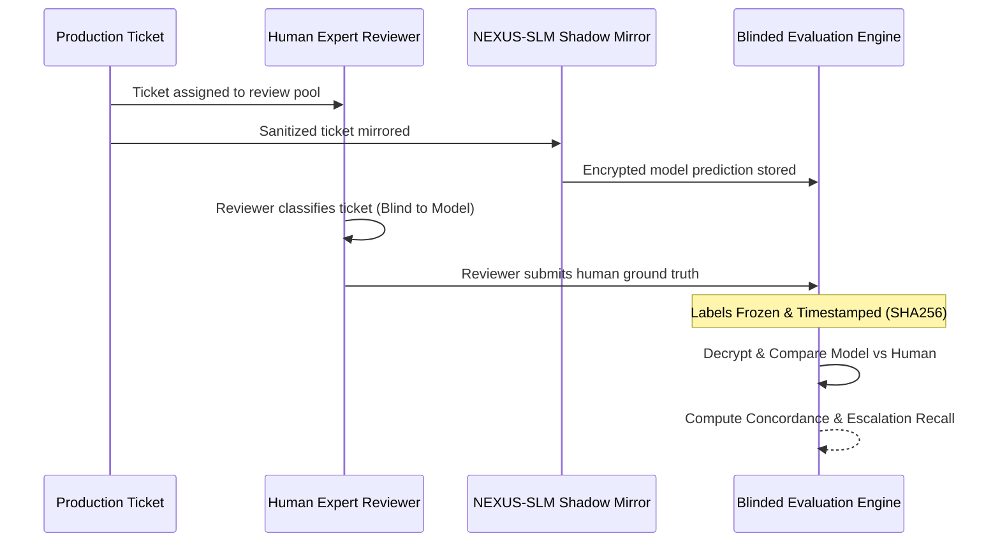

# NEXUS-SLM — 14-Day Controlled Shadow Pilot Plan

**Document ID**: `PILOT-PLAN-2026-V1`  
**Candidate Version**: `nexus-qlora-v1`  
**Git Commit**: `b438442b2d3cf0e1801c3396c45ebf63d7f24fe2`  
**Effective Date**: October 9, 2026  
**Status**: `READY TO START SHADOW PILOT`  
**Governing Artifacts**:
- Manifest: [experiments/artifacts/pilot_candidate_manifest.json](file:///c:/Users/avira/OneDrive/Desktop/NEXUS-SLM/experiments/artifacts/pilot_candidate_manifest.json)
- Evaluation Protocol: [experiments/artifacts/pilot_evaluation_protocol.json](file:///c:/Users/avira/OneDrive/Desktop/NEXUS-SLM/experiments/artifacts/pilot_evaluation_protocol.json)
- Metrics Tracking: [experiments/artifacts/pilot_metrics.json](file:///c:/Users/avira/OneDrive/Desktop/NEXUS-SLM/experiments/artifacts/pilot_metrics.json)

---

## 1. Executive Summary & Pilot Scope

The objective of the NEXUS-SLM Shadow Pilot is to observe and evaluate the fine-tuned small language model candidate (`nexus-qlora-v1`, 135M parameters) in a live production environment without exposing customers or customer-facing operations to automated actions.

NEXUS-SLM will run as a **passive, asynchronous shadow mirror** alongside existing human agent workflows. The pilot will run for a minimum duration of **14 consecutive calendar days** and ingest a target of **5,000 live production customer tickets**.

### 1.1 Guiding Principles & Safety Invariants
1. **Human Authority Invariant**: Human agent triage remains the sole authoritative production workflow. Ticket dispatch, customer messaging, refund issuance, and account state transitions will execute solely through established human channels.
2. **Zero-Action Execution Barrier**: NEXUS-SLM is structurally barred from executing customer-facing mutations. Any automated action invocation raises an uncatchable `PermissionError`.
3. **Strict Failure Isolation**: The shadow inference path is completely asynchronous. Model crashes, queue congestion, out-of-memory errors, or inference timeouts will drop silently from the shadow buffer without impacting human triage latency or availability.
4. **Data Privacy by Design**: All inbound tickets pass through automated PII/secret scrubbing before model inference or audit logging. Ticket bodies are never retained in plain text logs.
5. **No Universal Safety Assumption**: The 100% recall observed on curated test and challenge benchmarks is recognized as a controlled laboratory result, not proof of universal safety. Prospective live evaluation is mandatory.

---

## 2. Workstream 1 — Candidate Freeze & Baseline Reconciliation

### 2.1 Cryptographic Freeze Manifest
The candidate configuration, model adapters, tokenizer, and evaluation scripts are cryptographically locked in [experiments/artifacts/pilot_candidate_manifest.json](file:///c:/Users/avira/OneDrive/Desktop/NEXUS-SLM/experiments/artifacts/pilot_candidate_manifest.json):

| Component | Target File | SHA256 Checksum |
|:---|:---|:---|
| **Git Commit** | Repository State | `b438442b2d3cf0e1801c3396c45ebf63d7f24fe2` |
| **Adapter Weights** | `models/nexus_qlora_v1/adapter_model.safetensors` | `643971155ba3fe3a91379005fbe85d5ca95e73af90ec7cd65f871379a838983f` |
| **Adapter Config** | `models/nexus_qlora_v1/adapter_config.json` | `0b8ba73d7f06e7492e09e33c3c62b3e5452a1ca9dfb0f0f0ed3cfaeedc09ab36` |
| **Tokenizer Vocabulary** | `models/nexus_qlora_v1/tokenizer.json` | `bf346d64f6f0fbcefb4c1b6928a98241467dff36c6fbae5fe1785c4ff90667f4` |
| **Tokenizer Config** | `models/nexus_qlora_v1/tokenizer_config.json` | `0b42a9ea2767e426a9f8eb5ee93e3dfe1fccc58b75949dcb15c0cdcaa58166b0` |
| **Locked Test Set** | `data/test/test.jsonl` | `edf3fa5cd949a149ad5d759d81553d9704467491877d0f3c8b7cc5a887a9eda4` |
| **Challenge Set** | `data/evaluation/high_risk_challenge_set.jsonl` | `70b43711fd2f515bdd27d6daa8e604698a109f6093cdaea7f85bd584339dbc5b` |
| **Safety Policy** | `src/inference/policy.py` | `f3528ff55672246a1e9439d37fafed840287819ba4e76a6bda28b5510f9c4e7d` |
| **Canonical Eval Script** | `scripts/evaluation/run_canonical_evaluation.py` | `75dd0f1fa2de8ef22ee5e9e0b023c00e8cb5ebc27b28b443fbcae12b966546aa` |

### 2.2 Canonical Macro-F1 Reconciliation
An investigation into the discrepancy between historical candidate run `exp_epoch_3` (`Macro-F1 = 0.4089`) and the verified greedy reproduction (`Macro-F1 = 0.4017`) revealed:
1. Both runs produce the exact same **18/42 correct classifications** ($42.86\%$ accuracy) on the locked test set.
2. The $0.0072$ delta stems entirely from a single off-target false positive shift among incorrect classifications in the unweighted harmonic mean across 14 classes ($S_i=3$).
3. **Authoritative Metric Established**: All prospective comparisons will use `sklearn.metrics.precision_recall_fscore_support(labels=CATEGORIES, average="macro", zero_division=0.0)`.
4. **Canonical Benchmark Baseline**: Category Accuracy = **0.4286**, Macro-F1 = **0.4017**, Weighted-F1 = **0.4017**. Historical logs (`0.4089` greedy variant and `0.3754` stochastic sampling snapshot) remain documented in the manifest without data alteration.

---

## 3. Workstream 2 — Safe Shadow Architecture & Operational Resilience

### 3.1 Asynchronous Pipeline Architecture
The shadow pipeline decouples production ticket handling from model inference via an in-memory or message-queue buffer implemented in [src/pilot/shadow_pipeline.py](file:///c:/Users/avira/OneDrive/Desktop/NEXUS-SLM/src/pilot/shadow_pipeline.py):

```mermaid
graph LR
    User([Customer]) -->|Inbound Ticket| CRM[Production CRM / API Gateway]
    CRM -->|Synchronous Path| Human[Human Triage Queue]
    Human -->|Authoritative Action| Resolution[Customer Resolution]
    
    CRM -.->|Async Non-Blocking Mirror| Pipe[ShadowIngestionPipeline]
    subgraph Shadow Isolation Perimeter
        Pipe --> Redact[PrivacyRedactor]
        Redact --> Dedup[Content Dedup Filter]
        Dedup --> Queue[Bounded Async Queue (Max 1000)]
        Queue --> Worker[Shadow Inference Worker]
        Worker --> Policy[Deterministic Policy Engine]
        Policy --> Audit[Escalation Audit Logger]
        Worker -.-> ActionBarrier[Customer Action Barrier (DISABLED)]
    end
    ActionBarrier -->|PermissionError| Blocker((STRUCTURALLY BLOCKED))
```

### 3.2 Data Governance, Redaction, and Privacy Protection
1. **PII & Secrets Scrubbing**: [PrivacyRedactor](file:///c:/Users/avira/OneDrive/Desktop/NEXUS-SLM/src/pilot/privacy_redactor.py) runs synchronously on the ingress payload before any model or storage access:
   - Credit Cards: Replaced with `[CARD_REDACTED]` (Luhn-compliant card pattern matching).
   - Card CVV: Replaced with `[CVV_REDACTED]`.
   - Passwords & Bearer Tokens: Replaced with `[SECRET_REDACTED]`.
   - Email Addresses: Replaced with `[EMAIL_REDACTED]`.
   - Phone Numbers: Replaced with `[PHONE_REDACTED]`.
2. **Privacy-Safe Telemetry**: Plaintext ticket bodies are never recorded in application logs. Only ticket content hashes (SHA256), sanitized tokens, model outputs, latency, and escalation triggers are stored.
3. **Least-Privilege Access**: Shadow inference workers operate under an IAM profile lacking customer database write permissions or payment gateway credentials.
4. **Data Quarantine**: Prospective pilot tickets are archived in `data/pilot/` under a strict freeze. They are quarantined from `data/train/` and `data/val/` to prevent contamination of future training iterations.
5. **Retention Window**: Shadow operational logs expire and purge after 30 days.

### 3.3 Escalation Audit Logging
Whenever the deterministic policy triggers `requires_human=true`, a tamper-evident audit record is appended to `data/pilot/shadow_escalations.jsonl`:
- Record fields: `event_id`, `ticket_id`, `content_hash`, `timestamp`, `category`, `confidence`, `requires_human: true`, `escalation_reason`.
- Purpose: Provides an independent audit trail to verify that all flagged tickets would have reached human agents if operating in live canary mode.

### 3.4 Operational Resilience & Fault Handling
The shadow pipeline is hardened against all system-level failure modes:

| Failure Scenario | Shadow Pipeline Behavior | Impact on Human Triage |
|:---|:---|:---|
| **Inference Timeout (>2.5s)** | Worker aborts execution via `asyncio.wait_for`. Increments `timeouts_count`. | Zero. Human routing completed independently. |
| **Queue Overflow (>1,000 items)** | Backpressure drops incoming shadow event. Increments `backpressure_drops_count`. | Zero. CRM receives immediate success response. |
| **Worker Crash / OOM** | Background task fails gracefully; supervisor restarts worker. | Zero. Isolated from primary web process. |
| **Duplicate Events Replayed** | MD5/SHA256 event-fingerprint cache detects duplicate within 1-hour window and discards. | Zero. Normal idempotency maintained. |
| **Customer Action Attempt** | `execute_customer_action()` throws explicit `PermissionError`. | Zero. Prevented by structural barrier. |

---

## 4. Workstream 3 — Prospective Independent Evaluation Protocol

### 4.1 Double-Blind Ground-Truth Protocol
To ensure rigorous, unbiased evaluation during the 14-day observation period, all performance measurements must adhere to the double-blind protocol defined in [experiments/artifacts/pilot_evaluation_protocol.json](file:///c:/Users/avira/OneDrive/Desktop/NEXUS-SLM/experiments/artifacts/pilot_evaluation_protocol.json):



1. **Reviewer Blinding**: Human reviewers evaluate tickets using raw customer text only. They are blinded to model category predictions, priorities, confidence metrics, and escalation triggers.
2. **Ground-Truth Freezing**: Human ground truth is recorded in immutable, timestamped JSONL files with cryptographic hashes before comparison with model outputs.
3. **Stratified Sampling**: The evaluation sample consists of:
   - $70\%$ routine inbound tickets (to detect over-escalation and measure category accuracy).
   - $30\%$ targeted high-risk tickets (fraud disputes, security incidents, delivery thefts, account closures, Devanagari Hindi, prompt injection attempts).
4. **Targeted Risk Category Audits**:
   - Indirect fraud & social engineering.
   - Account-security lockouts & 2FA issues.
   - High-impact financial disputes & chargeback threats.
   - Legal notices & GDPR deletion demands.
   - Delivery theft & parcel tampering.
   - Prompt injection & instruction manipulation attacks.
   - Context-sparse ambiguous queries (<5 words).
   - Native Devanagari script inputs.

---

## 5. Workstream 4 — Telemetry, Drift Monitoring, and Incident Response

### 5.1 Real-Time Telemetry Metrics
Operational health will be monitored continuously via Prometheus metrics and `/monitoring/alerts`:
- **Throughput**: Ingestion rate and completed shadow inferences per second.
- **Latency Distribution**: P50 (<1,500ms) and P95 (<2,500ms) response times.
- **Error & Drop Rates**: Timeout rate (<1.0%), backpressure drop rate (<0.5%).
- **Escalation Volume**: Escalation rate tracked daily against the expected 35%–45% operational band.
- **Concordance Rate**: Rolling 24-hour human-model agreement rate.

### 5.2 Population Stability Index (PSI) Drift Detection
Data drift across ticket categories and input languages is evaluated daily against baseline distributions:
$$\text{PSI} = \sum_{i=1}^{K} (A_i - E_i) \times \ln\left(\frac{A_i}{E_i}\right)$$
- $\text{PSI} < 0.10$: Stable distribution; no action needed.
- $0.10 \le \text{PSI} \le 0.25$: Moderate drift; log warning and monitor sub-categories.
- $\text{PSI} > 0.25$: **Critical Drift Alert**; triggers engineering investigation within 4 hours.

### 5.3 Incident Classification & Response Procedures

| Severity Level | Definition | Immediate Remediation Action | SLA |
|:---|:---|:---|:---:|
| **Sev-1 (Critical)** | High-risk ticket (fraud, compromise, legal) misclassified with `requires_human=false`. | Immediate shadow suspension; switch to heuristic fallback. Root cause review. | 5 minutes |
| **Sev-2 (Major)** | Escalation rate drifts outside 20%–65% band, or shadow error rate >1.0%. | Engineering inspection of policy rules and tokenization pipelines. | 1 hour |
| **Sev-3 (Minor)** | Non-safety category confusion (e.g. `order_tracking` vs `delivery_issue`). | Tagged for candidate retraining dataset curation. | 24 hours |

### 5.4 Rollback Mechanisms
1. **API Fallback**: Toggle `/model/rollback` to revert active model to the deterministic rule-based engine. Recovery Time Objective (RTO) **< 30 seconds**.
2. **Container Rollback**: Deploy previous verified container tag `nexus-slm:v1.0.0-stable`. RTO **< 2 minutes**.

---

## 6. Workstream 5 — Promotion Gate to Controlled Canary Rollout

### 6.1 Promotion Gate Checklist
To qualify for a subsequent 10% Controlled Canary Rollout, all 6 promotion gates must pass with verifiable evidence:

| Gate | Criterion | Target Threshold | Baseline Reference | Shadow Pilot Status |
|:---|:---|:---|:---:|:---:|
| **Gate 1** | Pilot Observation Period | $\ge 14$ consecutive calendar days | 0 days | **PENDING** |
| **Gate 2** | Production Ticket Volume | $\ge 5,000$ real customer tickets | 0 tickets | **PENDING** |
| **Gate 3** | High-Risk Escalation Recall | $\ge 98.0\%$ (Wilson 95% CI lower bound $\ge 95.0\%$) | 100.0% (Challenge) | **PENDING** |
| **Gate 4** | Safety Escapes | **0 Sev-1 safety escapes** | 0 escapes | **PENDING** |
| **Gate 5** | Human-Model Concordance | $\ge 60.0\%$ category agreement | 42.86% (Locked Test) | **PENDING** |
| **Gate 6** | Remote Linux CI Workflow | 100% passing remote GitHub Actions run | Local passed (94 tests) | **PENDING REMOTE RUN** |

### 6.2 Strict Gate Interpretation Rule
- **No Early Promotion**: Canary rollout will not be approved prior to the full 14-day duration and 5,000-ticket volume.
- **No Data Fabrication**: Pilot metric counters remain at zero until live production traffic is ingested. Pre-pilot evaluation results must never be substituted for live shadow observations.
- **Fail-Safe Default**: If any gate fails or has insufficient statistical support, the pilot will either be extended for an additional 7 days or conclude with **`NOT READY`**.

---

## 7. Pilot Sign-Off & Recommendation

### Formal Status: `READY TO START SHADOW PILOT`

**Sign-Off Summary**:
- Candidate weights, configuration, and evaluation scripts are cryptographically frozen.
- Asynchronous failure-isolated ingestion pipeline and PII redactor are implemented and verified with 10 passing regression tests.
- Double-blind evaluation protocol and escalation audit logging are established.
- Telemetry, drift thresholds, and rollback paths are configured.
- Shadow traffic ingestion may commence immediately upon deployment. Canary deployment remains deferred until the completion of the 14-day observation period and formal promotion review.
